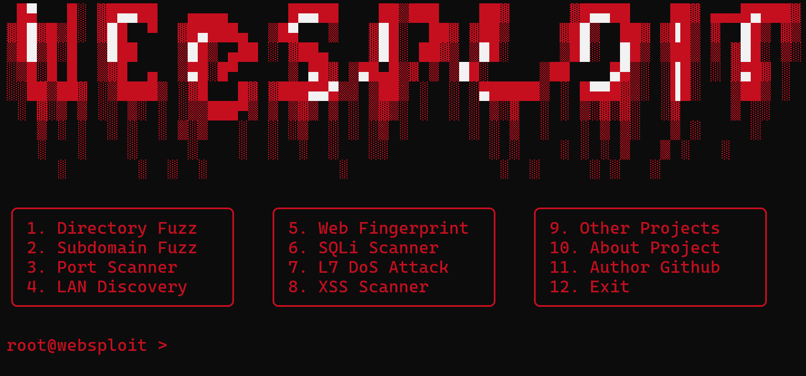

<div align="center">


# WebSploit

**Web Security Toolkit for Reconnaissance & Vulnerability Analysis**

<a href="https://github.com/AmirCyberSecurity/WebSploit/stargazers"></a>
<a href="https://github.com/AmirCyberSecurity/WebSploit/issues"></a>
<a href="https://www.python.org/"></a>
<a href="https://github.com/AmirCyberSecurity/WebSploit"></a>

</div>

---

## Overview

WebSploit is a Python-based Web Security Toolkit for reconnaissance, vulnerability analysis, and network discovery. It combines multiple security modules in a single command-line interface.

## Features

| Module | Description |
|:--|:--|
| Directory Fuzzing | Discover accessible directories and web resources |
| Subdomain Fuzzing | Find subdomains associated with a domain |
| Port Scanner | Check network ports and service availability |
| LAN Discovery | Discover devices on a local network |
| Web Fingerprinting | Identify technologies used by web applications |
| SQLi Scanner | Check for potential SQL injection vulnerabilities |
| XSS Scanner | Test for potential cross-site scripting vulnerabilities |
| L7 DoS | Controlled application-layer stress testing in isolated labs |

## Platform Support

Linux and Windows.

## Installation

```bash
git clone https://github.com/AmirCyberSecurity/WebSploit.git
cd WebSploit
python -m pip install -r requirements.txt
```

## Usage

```bash
python websploit.py
```

Or use the launcher:

```bash
python launch.py
```

## Requirements

- Python 3
- requests
- dnspython
- scapy

## Project Structure

```text
WebSploit/
├── lib/
├── lists/
├── image.png
├── launch.py
├── requirements.txt
├── websploit.py
└── README.md
```

## Preview

<div align="center">

</div>

## Disclaimer

WebSploit is intended for educational purposes and authorized security testing.

Only test systems you own or have explicit permission to assess. Use stress-testing features exclusively in authorized, isolated environments.

The author is not responsible for misuse or damage resulting from unauthorized activity.

<div align="center">

**WebSploit | Web Security Toolkit**

</div>
